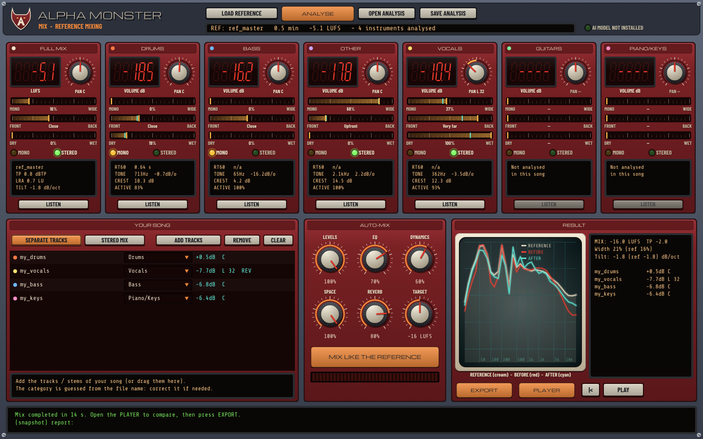
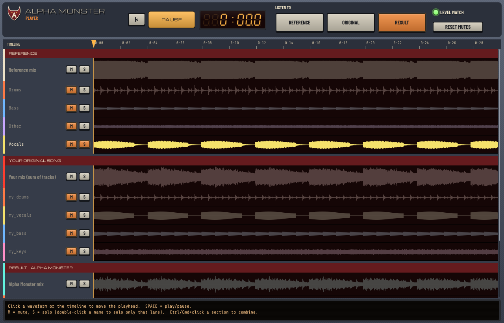

# Alpha Monster

**English** · [Italiano](#italiano)

**Reference-based mixing and mastering** for macOS and Windows.

Give Alpha Monster a song that sounds the way you want. It separates the instruments with AI, measures how they were mixed and mastered, and moves your song towards that sound.

| Product | Format | What it does |
|---|---|---|
| **Alpha Monster Mix** | Standalone app (macOS, Windows) | Separates the reference instruments with AI, shows the mix parameters of each instrument and mixes your song following them |
| **Alpha Monster Master** | **VST3**, **AU** plug-in and standalone app | Analyses the mastering of the reference and applies it to your song: match EQ, glue compressor, multiband stereo image, true-peak limiter and loudness |

> Mixing needs the AI separation, which takes minutes of computation: that is why it is an app and not a real-time plug-in. Mastering runs in real time inside any DAW or video editor.

---

## Alpha Monster Mix



### What it analyses in the reference (for each instrument)

Separation uses **6-source Demucs v4**: vocals, drums, bass, guitars, piano/keys and other.

| Parameter | How it is measured |
|---|---|
| **Level** | BS.1770 loudness of the instrument relative to the mix (dB) |
| **Pan (left/right)** | L/R energy balance converted to a pan position (constant-power law) |
| **Mono / stereo and width** | L/R coherence per frequency: 0% = mono (even when panned), 100% = fully decorrelated |
| **Depth** | Combination of reverb amount, transient softness and high-frequency loss |
| **Reverb** | Decay time (RT60) after hits and note endings, tail energy, tail decorrelation |
| **Tone** | 1/3-octave spectrum (31 bands), spectral centroid, tilt in dB/octave |
| **Dynamics** | Crest factor, LRA, true peak |

All these values are *acoustic estimates*: they describe how the instrument sounds, they do not read the plug-ins used in the original song.

### Automatic mix

Two ways to use it:

1. **Separate tracks** (recommended): load the stems of your song. The category is guessed from the file name (`vocals.wav`, `kick.wav`, `bass.wav`...) and you can correct it.
2. **Stereo mix**: load your finished mix. Alpha Monster separates it with AI and remixes it.

For each instrument group Alpha Monster:

- applies a **matching EQ** (31 bands) to get closer to the tone;
- compresses when your instrument is more dynamic than the reference;
- sets **pan** and **width** (M/S, or mono-compatible pseudo-stereo for mono sources), measuring the result at every step;
- adds **reverb** until it reaches the same depth;
- sets the **levels** to get the same balance as the reference, at the loudness you choose (pre-master, -16 LUFS by default).

**EXPORT** gives you:

- the mix as a 24-bit WAV;
- every processed track;
- a **report** with every parameter to recreate in your DAW: fader, pan, EQ, compressor, reverb (`Report mix.txt` and `Mix settings.json`).

The Levels / EQ / Dynamics / Space / Reverb knobs decide how closely to follow the reference (0-100%).

### Player



The **PLAYER** button (or **LISTEN** on each instrument) opens a window with the waveform of everything you can listen to:

- **Reference**: the mix and each separated instrument;
- **Your original song**: your mix and your tracks (or the AI-separated instruments, in stereo mix mode);
- **Result**: the Alpha Monster mix and each processed track.

Player features:

- **Play / pause** with the button or the space bar.
- **Click the waveform** or the timeline to move the playhead anywhere.
- **M** (mute) and **S** (solo) on every lane. Double-click a name to solo only that lane.
- **LISTEN** on a reference instrument solos it and moves the playhead to where it starts playing: no need to wait for the vocals to come in.
- **REFERENCE / ORIGINAL / RESULT** for instant A/B. Ctrl/Cmd+click to hear more than one together.
- **LEVEL MATCH** plays every section at the same loudness, for a fair comparison.

---

## Alpha Monster Master


The Master plug-in interface is in Italian; the English meaning of each button is given below.

1. **CARICA REF** (load reference): choose or drop the reference master. It measures integrated loudness, true peak, LRA, PLR, tonal curve, 3-band stereo width and correlation.
2. **LEARN**: play your song in the DAW and press again to stop. Alternatively use **ANALIZZA FILE** (analyse file) on a bounce.
3. The plug-in computes:
   - **Match EQ**: 31-band correction curve, minimum phase, zero latency;
   - **Glue Comp**: threshold and ratio set automatically from your material;
   - **Stereo Width**: side gain for lows, mids and highs (crossovers 200 Hz / 4 kHz) to match the reference image, with a *Bass Mono* option;
   - **Limiter**: true-peak with look-ahead and 2x oversampling, adjustable ceiling (-1 dBTP by default);
   - **Drive**: proposed automatically to reach the reference loudness.
4. **MATCH**: during playback, fine-tunes Drive until the integrated output loudness equals the reference.
5. **ASCOLTA REF** (listen to reference): instant A/B with the reference. The **reference waveform** under the VU meter shows where you are: click any point to listen to the reference from there (it plays while the DAW is playing).
6. **BOOST**: a "to taste" knob that adds level (up to +6 dB) and soft saturation before the limiter.
7. **BYPASS**: compares with your original signal, latency-compensated and click-free. It is also the host bypass parameter.

Alpha Monster Master uses its own graphite, orange and cyan look, so it is easy to tell apart from Alpha Monster Mix.

The CRT screen shows the reference, your song, the live output and the EQ curve together. The state (reference and analysis) is saved with the DAW project.

### Compatibility

| Format | Where it works |
|---|---|
| **AU** (macOS) | Logic Pro, GarageBand, Final Cut Pro, Ableton Live, Studio One, Reaper, DaVinci Resolve |
| **VST3** (macOS and Windows) | Ableton Live, Cubase/Nuendo, FL Studio, Reaper, Studio One, Bitwig, DaVinci Resolve/Fairlight, Adobe Premiere Pro/Audition, Vegas |
| **Standalone** | Without a DAW, with audio input |

Pro Tools only supports AAX, which requires an Avid developer account for signing: it is not included.

---

## Download and installation

Download the latest version from the [Releases](../../releases) page:

- **macOS**: `AlphaMonster-x.y.z-macOS.pkg` (Universal: Apple Silicon and Intel, macOS 10.15+)
- **Windows**: `AlphaMonster-x.y.z-Windows-Setup.exe` (Windows 10/11 64-bit)

For details, including the first launch of an unsigned app on macOS, see [docs/INSTALL.md](docs/INSTALL.md).

---

## Building from source

You need CMake 3.22+ and a C++17 compiler (Xcode 14+ on macOS, Visual Studio 2022 on Windows). Dependencies are downloaded automatically.

```bash
cmake -S . -B build -DCMAKE_BUILD_TYPE=Release \
      -DAM_MODEL_FILE=/path/ggml-model-htdemucs-6s-f16.bin   # optional: bundles the AI model in the app
cmake --build build --config Release --parallel
```

The AI model (`ggml-model-htdemucs-6s-f16.bin`) is on [Hugging Face](https://huggingface.co/datasets/Retrobear/demucs.cpp). If it is not bundled, Alpha Monster Mix offers to download it the first time.

Development tools included:

- `am_analyze`: prints the analysis of one or more files;
- `am_separate`: AI separation from the command line;
- `am_snapshot`: runs the whole workflow and saves the interfaces as PNG screenshots.

Every push is built and tested by GitHub Actions on macOS and Windows: analysis, real AI separation, screenshots, `auval` and `pluginval`. Every successful build of `main` publishes, or updates, the release of the version written in `CMakeLists.txt`.

### Layout

```
Source/Shared/Analysis   BS.1770 loudness, true peak, spectral/stereo/space analysis, match EQ
Source/Shared/Dsp        compressor, multiband width, true-peak limiter
Source/Shared/UI         Alpha Monster graphics (LookAndFeel, displays, VU, CRT)
Source/MixApp            Alpha Monster Mix app (AI separation, automatic mix, player)
Source/MasterPlugin      Alpha Monster Master plug-in
Tools                    test tools
installer                macOS (.pkg) and Windows (Inno Setup) packages
```

## Third-party licences

See [THIRD_PARTY.md](THIRD_PARTY.md). Alpha Monster uses JUCE 8: distributing it as closed-source software beyond the limits of the JUCE Starter licence requires a commercial JUCE licence. Otherwise the code must be released under AGPLv3.

---
---

<a id="italiano"></a>

# Alpha Monster (Italiano)

[English](#alpha-monster) · **Italiano**

**Mixing e mastering guidati da un brano di riferimento** per macOS e Windows.

Dai ad Alpha Monster un brano che suona come vorresti. Lui ne separa gli strumenti con l'IA, misura come sono stati mixati e masterizzati e porta il tuo brano verso quel suono.

| Prodotto | Formato | A cosa serve |
|---|---|---|
| **Alpha Monster Mix** | App standalone (macOS, Windows) | Separa gli strumenti del reference con l'IA, mostra i parametri di mix di ogni strumento e mixa il tuo brano seguendoli |
| **Alpha Monster Master** | Plugin **VST3**, **AU** e app standalone | Analizza il mastering del reference e lo applica al tuo brano: match EQ, glue comp, immagine stereo multibanda, limiter true-peak e loudness |

> Il mixing ha bisogno della separazione IA, che richiede minuti di calcolo: per questo è un'app e non un plugin in tempo reale. Il mastering invece lavora in tempo reale dentro qualunque DAW o editor video.

---

## Alpha Monster Mix


### Cosa analizza del reference (per ogni strumento)

La separazione usa **Demucs v4 a 6 sorgenti**: voce, batteria, basso, chitarre, piano/tastiere e altro.

| Parametro | Come viene misurato |
|---|---|
| **Volume** | Loudness BS.1770 dello strumento rispetto al mix (dB) |
| **Pan (sinistra/destra)** | Bilanciamento energetico L/R convertito in posizione di pan (legge a potenza costante) |
| **Mono / stereo e larghezza** | Coerenza L/R per frequenza: 0% = mono (anche se pannato), 100% = completamente decorrelato |
| **Profondità** | Combinazione di quantità di riverbero, morbidezza dei transienti e perdita di alte frequenze |
| **Riverbero** | Tempo di decadimento (RT60) dopo colpi e fine delle note, energia della coda, decorrelazione della coda |
| **Tono** | Spettro a 1/3 d'ottava (31 bande), baricentro spettrale, inclinazione in dB/ottava |
| **Dinamica** | Crest factor, LRA, true peak |

Tutti questi valori sono *stime acustiche*: indicano come suona lo strumento, non leggono i plugin usati nel brano originale.

### Mix automatico

Puoi usarlo in due modi:

1. **Tracce separate** (consigliato): carichi gli stem del tuo brano. La categoria viene proposta dal nome del file (`voce.wav`, `kick.wav`, `bass.wav`...) e puoi correggerla.
2. **Mix stereo**: carichi il tuo mix già fatto. Alpha Monster lo separa con l'IA e lo rimixa.

Per ogni gruppo di strumenti, Alpha Monster:

- applica un **EQ di matching** (31 bande) per avvicinare il timbro;
- comprime se il tuo strumento è più dinamico del reference;
- regola **pan** e **larghezza** (M/S oppure pseudo-stereo mono-compatibile per le sorgenti mono), misurando il risultato a ogni passo;
- aggiunge **riverbero** fino a raggiungere la stessa profondità;
- regola i **volumi** per ottenere lo stesso bilanciamento del reference, al livello di loudness che scegli (pre-master, predefinito -16 LUFS).

Con **ESPORTA** ottieni:

- il mix in WAV 24 bit;
- ogni traccia processata;
- un **report** con tutti i parametri da riportare nella tua DAW: fader, pan, EQ, compressore, riverbero (`Report mix.txt` e `Parametri mix.json`).

Le manopole Levels / EQ / Dynamics / Space / Reverb decidono quanto seguire il reference (0-100%). L'interfaccia di Alpha Monster Mix è in inglese.

### Player


Il pulsante **PLAYER** (oppure **LISTEN** su ogni strumento) apre una finestra con la forma d'onda di tutto ciò che si può ascoltare:

- **Reference**: il mix e ogni strumento separato;
- **Your original song**: il tuo mix e le tue tracce (o gli strumenti separati dall'IA, in modalità mix stereo);
- **Result**: il mix di Alpha Monster e ogni traccia processata.

Funzioni del player:

- **Play / pausa** con il pulsante o la barra spaziatrice.
- **Clic sulla forma d'onda** o sulla timeline per spostare la testina dove vuoi.
- **M** (mute) e **S** (solo) su ogni traccia. Doppio clic sul nome mette in solo solo quella traccia.
- **LISTEN** su uno strumento del reference lo mette in solo e porta la testina al punto in cui inizia a suonare: non serve aspettare che entri la voce.
- **REFERENCE / ORIGINAL / RESULT** per il confronto A/B immediato. Ctrl/Cmd+clic per ascoltarne più di uno insieme.
- **LEVEL MATCH** porta tutte le sezioni alla stessa loudness, per un confronto onesto.

---

## Alpha Monster Master


1. **CARICA REF**: scegli o trascina il master di riferimento. Ne vengono misurati loudness integrata, true peak, LRA, PLR, curva tonale, larghezza stereo su 3 bande e correlazione.
2. **LEARN**: fai suonare il tuo brano nella DAW e premi di nuovo per fermare. In alternativa usa **ANALIZZA FILE** su un bounce.
3. Il plugin calcola:
   - **Match EQ**: curva di correzione a 31 bande, a fase minima e senza latenza;
   - **Glue Comp**: soglia e rapporto automatici dal tuo materiale;
   - **Stereo Width**: guadagno side per bassi, medi e alti (crossover 200 Hz / 4 kHz) per avvicinare l'immagine al reference, con opzione *Bass Mono*;
   - **Limiter**: true-peak con look-ahead e oversampling 2x, ceiling regolabile (predefinito -1 dBTP);
   - **Drive**: proposto automaticamente per raggiungere la loudness del reference.
4. **MATCH**: durante la riproduzione affina il Drive finché la loudness integrata in uscita coincide con quella del reference.
5. **ASCOLTA REF**: confronto A/B immediato con il reference. La **forma d'onda del reference** sotto il VU meter mostra dove sei: clicca un punto qualsiasi per ascoltare il reference da lì (suona mentre la DAW è in riproduzione).
6. **BOOST**: manopola "a gusto personale" che aggiunge volume (fino a +6 dB) e saturazione morbida prima del limiter.
7. **BYPASS**: confronto con il segnale originale, compensato in latenza e senza click. È anche il parametro di bypass per la DAW.

Alpha Monster Master ha una grafica propria grigio grafite, arancio e ciano, per distinguerlo da Alpha Monster Mix.

Lo schermo CRT mostra insieme reference, tuo brano, uscita in tempo reale e curva EQ. Lo stato (reference e analisi) viene salvato nel progetto della DAW.

### Compatibilità

| Formato | Dove funziona |
|---|---|
| **AU** (macOS) | Logic Pro, GarageBand, Final Cut Pro, Ableton Live, Studio One, Reaper, DaVinci Resolve |
| **VST3** (macOS e Windows) | Ableton Live, Cubase/Nuendo, FL Studio, Reaper, Studio One, Bitwig, DaVinci Resolve/Fairlight, Adobe Premiere Pro/Audition, Vegas |
| **Standalone** | Senza DAW, con ingresso audio |

Pro Tools usa solo il formato AAX, che richiede un account sviluppatore Avid per la firma: non è incluso.

---

## Download e installazione

Scarica l'ultima versione dalla pagina [Releases](../../releases):

- **macOS**: `AlphaMonster-x.y.z-macOS.pkg` (Universal: Apple Silicon e Intel, macOS 10.15+)
- **Windows**: `AlphaMonster-x.y.z-Windows-Setup.exe` (Windows 10/11 64 bit)

Per i dettagli, incluso il primo avvio su macOS di un'app non firmata, vedi [docs/INSTALLAZIONE.md](docs/INSTALLAZIONE.md) (in inglese: [docs/INSTALL.md](docs/INSTALL.md)).

---

## Compilare dai sorgenti

Servono CMake 3.22+ e un compilatore C++17 (Xcode 14+ su macOS, Visual Studio 2022 su Windows). Le dipendenze vengono scaricate automaticamente.

```bash
cmake -S . -B build -DCMAKE_BUILD_TYPE=Release \
      -DAM_MODEL_FILE=/percorso/ggml-model-htdemucs-6s-f16.bin   # opzionale: include il modello IA nell'app
cmake --build build --config Release --parallel
```

Il modello IA (`ggml-model-htdemucs-6s-f16.bin`) si trova su [Hugging Face](https://huggingface.co/datasets/Retrobear/demucs.cpp). Se non è incluso nell'app, Alpha Monster Mix si offre di scaricarlo al primo utilizzo.

Strumenti di sviluppo inclusi:

- `am_analyze`: stampa l'analisi di uno o più file;
- `am_separate`: separazione IA da riga di comando;
- `am_snapshot`: esegue l'intero flusso e salva le schermate delle interfacce in PNG.

Ogni push viene compilato e testato da GitHub Actions su macOS e Windows: analisi, separazione IA reale, schermate, `auval` e `pluginval`. Ogni build riuscita del ramo `main` pubblica, o aggiorna, la release della versione scritta in `CMakeLists.txt`.

### Struttura

```
Source/Shared/Analysis   loudness BS.1770, true peak, analisi spettrale/stereo/spazio, match EQ
Source/Shared/Dsp        compressore, width multibanda, limiter true-peak
Source/Shared/UI         grafica Alpha Monster (LookAndFeel, display, VU, CRT)
Source/MixApp            app Alpha Monster Mix (separazione IA, mix automatico, player)
Source/MasterPlugin      plugin Alpha Monster Master
Tools                    strumenti di test
installer                pacchetti macOS (.pkg) e Windows (Inno Setup)
```

## Licenze di terze parti

Vedi [THIRD_PARTY.md](THIRD_PARTY.md). Alpha Monster usa JUCE 8: per distribuirlo come software closed-source oltre i limiti della licenza JUCE Starter serve una licenza JUCE commerciale. In alternativa il codice va rilasciato sotto AGPLv3.
