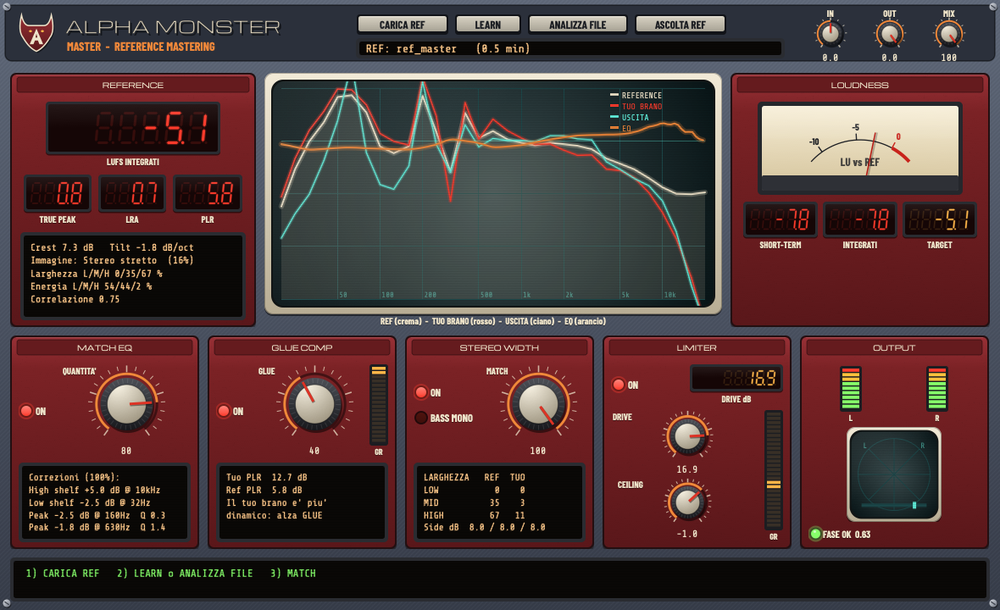

# Alpha Monster

**Mixing e mastering guidati da un brano di riferimento** per macOS e Windows.

Dai ad Alpha Monster un brano che suona come vorresti. Lui ne separa gli strumenti con l'IA, misura come sono stati mixati e masterizzati e porta il tuo brano verso quel suono.

| Prodotto | Formato | A cosa serve |
|---|---|---|
| **Alpha Monster Mix** | App standalone (macOS, Windows) | Separa gli strumenti del reference con l'IA, mostra i parametri di mix di ogni strumento e mixa il tuo brano seguendoli |
| **Alpha Monster Master** | Plugin **VST3**, **AU** e app standalone | Analizza il mastering del reference e lo applica al tuo brano: match EQ, glue comp, immagine stereo multibanda, limiter true-peak e loudness |

> Il mixing ha bisogno della separazione IA, che richiede minuti di calcolo: per questo è un'app e non un plugin in tempo reale. Il mastering invece lavora in tempo reale dentro qualunque DAW o editor video.

---

## Alpha Monster Mix


### Cosa analizza del reference (per ogni strumento)

La separazione usa **Demucs v4 a 6 sorgenti**: voce, batteria, basso, chitarre, piano/tastiere e altro.

| Parametro | Come viene misurato |
|---|---|
| **Volume** | Loudness BS.1770 dello strumento rispetto al mix (dB) |
| **Pan (sinistra/destra)** | Bilanciamento energetico L/R convertito in posizione di pan (legge a potenza costante) |
| **Mono / stereo e larghezza** | Coerenza L/R per frequenza: 0% = mono (anche se pannato), 100% = completamente decorrelato |
| **Profondità** | Combinazione di quantità di riverbero, morbidezza dei transienti e perdita di alte frequenze |
| **Riverbero** | Tempo di decadimento (RT60) dopo colpi e fine delle note, energia della coda, decorrelazione della coda |
| **Tono** | Spettro a 1/3 d'ottava (31 bande), baricentro spettrale, inclinazione in dB/ottava |
| **Dinamica** | Crest factor, LRA, true peak |

Tutti questi valori sono *stime acustiche*: indicano come suona lo strumento, non leggono i plugin usati nel brano originale.

### Mix automatico

Puoi usarlo in due modi:

1. **Tracce separate** (consigliato): carichi gli stem del tuo brano. La categoria viene proposta dal nome del file (`voce.wav`, `kick.wav`, `bass.wav`...) e puoi correggerla.
2. **Mix stereo**: carichi il tuo mix già fatto. Alpha Monster lo separa con l'IA e lo rimixa.

Per ogni gruppo di strumenti, Alpha Monster:

- applica un **EQ di matching** (31 bande) per avvicinare il timbro;
- comprime se il tuo strumento è più dinamico del reference;
- regola **pan** e **larghezza** (M/S oppure pseudo-stereo mono-compatibile per le sorgenti mono), misurando il risultato a ogni passo;
- aggiunge **riverbero** fino a raggiungere la stessa profondità;
- regola i **volumi** per ottenere lo stesso bilanciamento del reference, al livello di loudness che scegli (pre-master, predefinito -16 LUFS).

Con **ESPORTA** ottieni:

- il mix in WAV 24 bit;
- ogni traccia processata;
- un **report** con tutti i parametri da riportare nella tua DAW: fader, pan, EQ, compressore, riverbero (`Report mix.txt` e `Parametri mix.json`).

Le manopole Livelli / EQ / Dinamica / Spazio / Riverbero decidono quanto seguire il reference (0-100%).

---

## Alpha Monster Master



1. **CARICA REF**: scegli o trascina il master di riferimento. Ne vengono misurati loudness integrata, true peak, LRA, PLR, curva tonale, larghezza stereo su 3 bande e correlazione.
2. **LEARN**: fai suonare il tuo brano nella DAW e premi di nuovo per fermare. In alternativa usa **ANALIZZA FILE** su un bounce.
3. Il plugin calcola:
   - **Match EQ**: curva di correzione a 31 bande, a fase minima e senza latenza;
   - **Glue Comp**: soglia e rapporto automatici dal tuo materiale;
   - **Stereo Width**: guadagno side per bassi, medi e alti (crossover 200 Hz / 4 kHz) per avvicinare l'immagine al reference, con opzione *Bass Mono*;
   - **Limiter**: true-peak con look-ahead e oversampling 2x, ceiling regolabile (predefinito -1 dBTP);
   - **Drive**: proposto automaticamente per raggiungere la loudness del reference.
4. **MATCH**: durante la riproduzione affina il Drive finché la loudness integrata in uscita coincide con quella del reference.
5. **ASCOLTA REF**: confronto A/B immediato con il reference.

Lo schermo CRT mostra insieme reference, tuo brano, uscita in tempo reale e curva EQ. Lo stato (reference e analisi) viene salvato nel progetto della DAW.

### Compatibilità

| Formato | Dove funziona |
|---|---|
| **AU** (macOS) | Logic Pro, GarageBand, Final Cut Pro, Ableton Live, Studio One, Reaper, DaVinci Resolve |
| **VST3** (macOS e Windows) | Ableton Live, Cubase/Nuendo, FL Studio, Reaper, Studio One, Bitwig, DaVinci Resolve/Fairlight, Adobe Premiere Pro/Audition, Vegas |
| **Standalone** | Senza DAW, con ingresso audio |

Pro Tools usa solo il formato AAX, che richiede un account sviluppatore Avid per la firma: non è incluso.

---

## Download e installazione

Scarica l'ultima versione dalla pagina [Releases](../../releases):

- **macOS**: `AlphaMonster-x.y.z-macOS.pkg` (Universal: Apple Silicon e Intel, macOS 10.15+)
- **Windows**: `AlphaMonster-x.y.z-Windows-Setup.exe` (Windows 10/11 64 bit)

Per i dettagli, incluso il primo avvio su macOS di un'app non firmata, vedi [docs/INSTALLAZIONE.md](docs/INSTALLAZIONE.md).

---

## Compilare dai sorgenti

Servono CMake 3.22+ e un compilatore C++17 (Xcode 14+ su macOS, Visual Studio 2022 su Windows). Le dipendenze vengono scaricate automaticamente.

```bash
cmake -S . -B build -DCMAKE_BUILD_TYPE=Release \
      -DAM_MODEL_FILE=/percorso/ggml-model-htdemucs-6s-f16.bin   # opzionale: include il modello IA nell'app
cmake --build build --config Release --parallel
```

Il modello IA (`ggml-model-htdemucs-6s-f16.bin`) si trova su [Hugging Face](https://huggingface.co/datasets/Retrobear/demucs.cpp). Se non è incluso nell'app, Alpha Monster Mix si offre di scaricarlo al primo utilizzo.

Strumenti di sviluppo inclusi:

- `am_analyze`: stampa l'analisi di uno o più file;
- `am_separate`: separazione IA da riga di comando;
- `am_snapshot`: esegue l'intero flusso e salva le schermate delle interfacce in PNG.

Ogni push viene compilato e testato da GitHub Actions su macOS e Windows: analisi, separazione IA reale, schermate, `auval` e `pluginval`. Pubblicare un tag `v*` crea automaticamente la release.

### Struttura

```
Source/Shared/Analysis   loudness BS.1770, true peak, analisi spettrale/stereo/spazio, match EQ
Source/Shared/Dsp        compressore, width multibanda, limiter true-peak
Source/Shared/UI         grafica Alpha Monster (LookAndFeel, display, VU, CRT)
Source/MixApp            app Alpha Monster Mix (separazione IA, mix automatico)
Source/MasterPlugin      plugin Alpha Monster Master
Tools                    strumenti di test
installer                pacchetti macOS (.pkg) e Windows (Inno Setup)
```

## Licenze di terze parti

Vedi [THIRD_PARTY.md](THIRD_PARTY.md). Alpha Monster usa JUCE 8: per distribuirlo come software closed-source oltre i limiti della licenza JUCE Starter serve una licenza JUCE commerciale. In alternativa il codice va rilasciato sotto AGPLv3.
